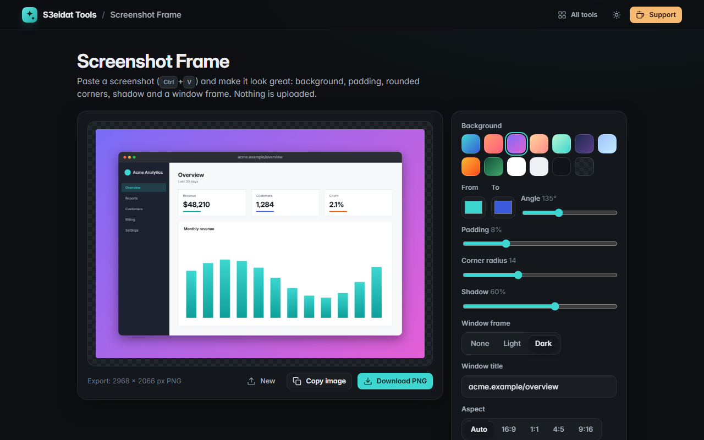

# Screenshot Frame

> Make screenshots look great for sharing. Free, private, and it runs entirely in your browser.

### ▶ [Open Screenshot Frame](https://s3eidat.github.io/screenshot-frame/)



## Features

- **Paste** a screenshot with Ctrl+V (or ⌘V), drop it, or pick a file
- **Backgrounds:** 9 gradient and solid presets, transparent, or your own two colours and angle
- **Padding**, **rounded corners** and a soft **shadow** (it follows the real shape, even for transparent PNGs)
- Optional **window frame** (light or dark, macOS-style dots) with a title
- **Aspect presets:** auto, 16:9, 1:1, 4:5 and 9:16; the screenshot stays centred
- **Export PNG at 2x** (or 1x), capped at 8192 px per side; or **copy the image** to the clipboard
- Remembers your style for next time

2x export makes the frame, shadow and title crisp on high-density screens; it can't add detail that isn't in the
original screenshot.

## Privacy

Your screenshot never leaves your device: it's drawn on a `<canvas>` in this page. There is no server, no account,
no analytics. The page ships with a strict Content-Security-Policy (`connect-src 'self'`), so the browser
itself blocks any attempt to send data anywhere.

## Run it yourself

It's plain HTML, CSS and JavaScript with no build step:

```bash
git clone https://github.com/s3eidat/screenshot-frame
cd screenshot-frame
python -m http.server 8000
```

Then open http://localhost:8000.

## Support

If this saved you time, **[buy me a coffee ☕](https://s3eidat.github.io/coffee/)**. It keeps every tool free.

---

Part of **[S3eidat Tools](https://s3eidat.github.io/)**: 100+ free, private tools that run in your browser. MIT licensed.
